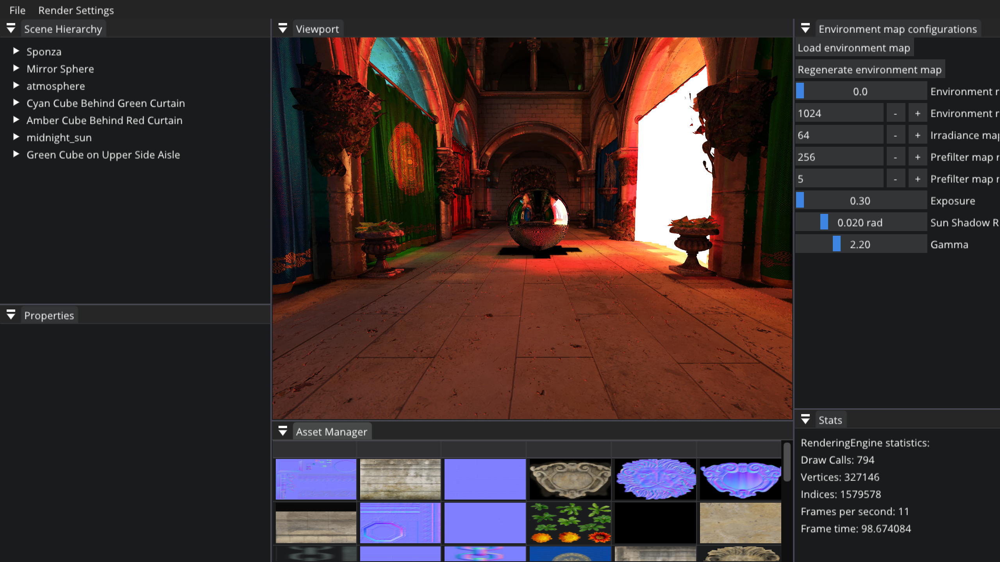

# M1 editor performance follow-up

Verified 2026-11-26 on Apple M1, MacBookPro17,1, 16 GiB, native arm64 Vulkan/MoltenVK.
The largest bottleneck was GPU material shading, not Debug CPU overhead.

## Debug and Release comparison

| Configuration                    | Before, ms/frame (FPS) | After, ms/frame (FPS) |
|----------------------------------|-----------------------:|----------------------:|
| Debug, all effects               |          327.28 (3.06) |         92.35 (10.83) |
| Release, all effects             |          320.54 (3.12) |         88.29 (11.33) |
| Debug, listed effects disabled   |          25.44 (39.30) |     8.23 (~120 limit) |
| Release, listed effects disabled |          23.05 (43.39) |     8.31 (~120 limit) |

Matched initial-camera Sponza runs used a 1280×720 logical window, 2560×1440
framebuffer, actual 4× MSAA (configured 8× clamped to M1 support), 128³ directional
voxel GI with four bounces, and the existing GI trace resolution. Each temporary
diagnostic executable ran 55 frames; measurements average the last 40. Timed runs
had no screenshot layer, validation layer, or concurrent build. CPU sections used
steady-clock measurements; GPU sections used timestamp queries. These are short
steady-scene measurements, not sustained thermal benchmarks.

The disabled-effects diagnostic switches off SSR, AO, VXGI, voxel sun shadows,
DoF, bloom, sun shafts, and sun flare. Geometry, sky, IBL, and basic shadows remain.
Release with those effects disabled and VSync enabled measured 59.81 FPS.

## Retained changes

- **Minimum-rate sample shading:** MoltenVK ran the expensive material shader per
  sample. The configured minimum of 0.2 requires only one invocation at 4× MSAA.
  Sample shading is now enabled only when that minimum requires multiple invocations.
  MSAA coverage remains 4×. The user explicitly approved this change after reviewing
  its small image difference; it is not claimed to be pixel-identical.
- **SSR:** cache repeated receiver texel reads and use conservative 8×8 maximum-depth
  bounds to reject impossible hits. Original ray steps, refinement, hit rules, and
  glossy filter budgets remain. Bounds include a floating-point error margin.
- **VXGI:** sample existing half-float radiance through hardware-filtered 3D mip
  textures instead of eight manual buffer reads per trilinear lookup. Resolution,
  directional weights, mip blending, cones, and bounces remain unchanged. Copies run
  when lighting is rebuilt. Extra storage is approximately 32 MiB at 128³;
  unsupported devices retain the buffer path.
- **Presentation:** honor VSync. M1 exposes FIFO and IMMEDIATE, but not MAILBOX.
  VSync-off can now use IMMEDIATE instead of silently choosing FIFO. Immediate
  presentation permits tearing; VSync-on retains FIFO.
- **Build correctness:** include vector template definitions used by mesh tangent
  generation, fixing a Release-only unresolved `Vector3<float>::cross` symbol.
  The resource test now reads the shader manifest correctly when compiler options
  follow its source/output arguments.

Release GPU GI tracing fell from 62.58 to 27.02 ms; the main pass fell from 246.88
to 43.88 ms. Blanket shader compiler optimization, early fragment tests, and moving
the sky draw did not provide a reliable gain and were not retained.

## Research and tradeoffs

The [Vulkan rasterization specification](https://docs.vulkan.org/spec/latest/chapters/primsrast.html)
defines minimum invocation counts. The chosen mapping honors the configured minimum
without forcing extra material
evaluations. [Vulkan present modes](https://docs.vulkan.org/refpages/latest/refpages/source/VkPresentModeKHR.html)
explain the FIFO/IMMEDIATE tradeoff.

[AMD SSSR](https://gpuopen.com/manuals/fidelityfx_sdk/techniques/stochastic-screen-space-reflections/)
uses depth acceleration; [McGuire and Mara](https://jcgt.org/published/0003/04/04/)
avoid oversampling with DDA traversal. Conservative tile rejection was selected
because replacing traversal could change which hit this engine selects. A
[sparse voxel octree](https://research.nvidia.com/publication/2010-02_efficient-sparse-voxel-octrees)
would require a representation redesign; filtered copies preserve existing grid data.
The [Vulkan timestamp sample](https://docs.vulkan.org/samples/latest/samples/api/timestamp_queries/README.html)
informs timing. The [wait-idle sample](https://docs.vulkan.org/samples/latest/samples/performance/wait_idle/README.html)
illustrates synchronization improvements, but removing this engine's queue wait needs
a shared-resource lifetime audit. Final Release CPU recording was only 0.78 ms.

## Build and test checks

- `premake5 cmake` and full arm64 Debug/Release builds passed for both applications.
  Release reused existing local OpenAL sources after a network fetch failed.
  The generated root CMake file was not hand-edited.
- `ctest --preset tests --output-on-failure`: 27/27 passed.
- `ctest --preset tests-release --output-on-failure`: 27/27 passed.
- `python3 tests/resource_pipeline.py`: passed, including 45 default/46 experimental
  shaders, incremental compilation, include tracking, compiler failures, install
  staging, and executable-relative resource lookup.
- PBR/background contracts passed; expanded OpenGL PBR shaders compiled and linked
  with glslangValidator. This is not OpenGL runtime verification.
- OpenAL null-driver smoke passed. Native M1 Vulkan compute smoke verified 256 values
  and pipeline recreation.

## Native rendering and image checks

Production Debug and Release editors each rendered through frame 20, including
continued rendering after focus moved to Finder. The Release sample application
rendered its default world through frame 8. All reported zero Vulkan validation errors.
A separate native stress run exercised resizing, camera movement, SSR/GI toggles,
and voxel resolution changes between 64³ and 128³, also with zero validation errors
and complete captures at both window sizes. Existing Cocoa icon/display-service
warnings did not prevent rendering.

All 54 fixed-pose quality fixtures were rerun: 48 were byte-identical; five changed
one channel by one level. The remaining sealed-chamber difference reproduced with
the old renderer; repeated old/new captures matched each other exactly.
Native matched viewport captures with the approved sample-rate change and all fixes
had mean absolute channel difference **0.0229/255**, maximum **4/255**. Without that
sample-rate change, shader optimizations measured 0.0096/255, maximum 1/255.
These comparisons support the tested scenes, not universal image equivalence.

## Still open

The all-effects scene is approximately 11 FPS, **not 60 FPS**. Main shading (~44 ms)
and GI tracing (~27 ms) remain the largest measured GPU costs. Further gains require
additional profiling and implementation work. Queue-wait removal remains deferred
pending a resource lifetime audit. Windows and native OpenGL runtime parity were not
tested. Raw profiling outputs and temporary diagnostic programs are not tracked.
No commit or merge was made.
