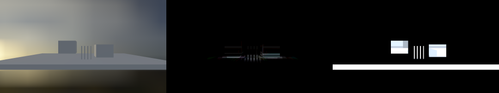
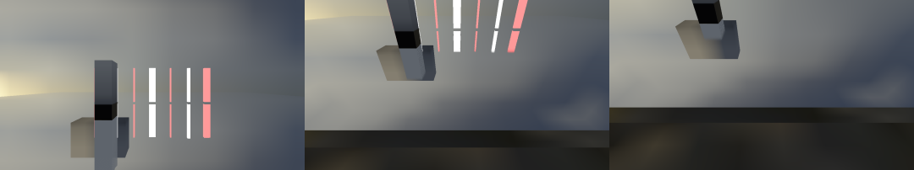
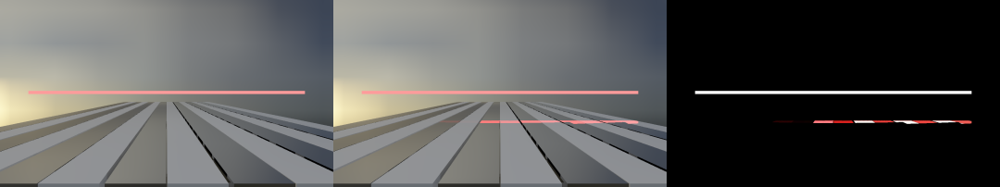
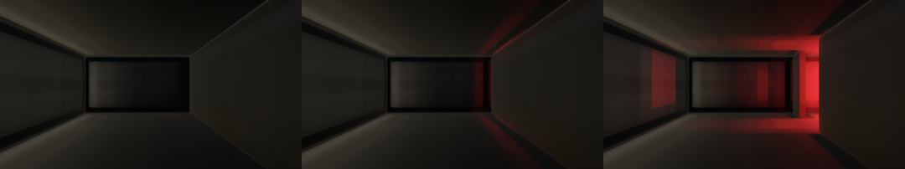
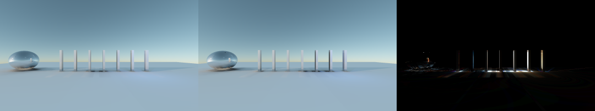
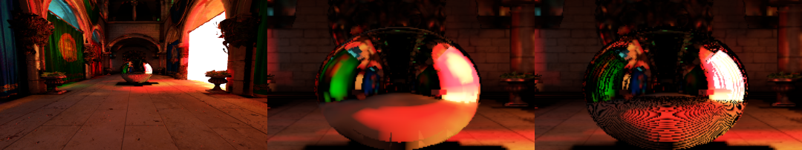
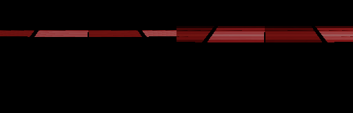
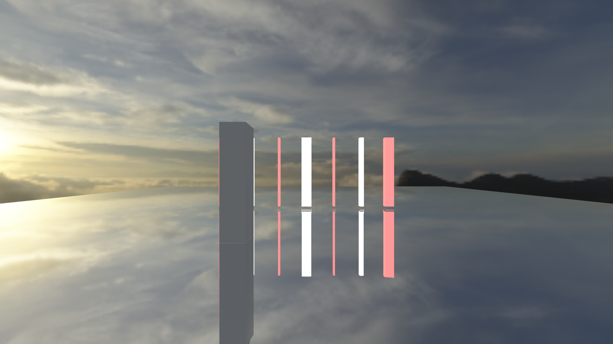
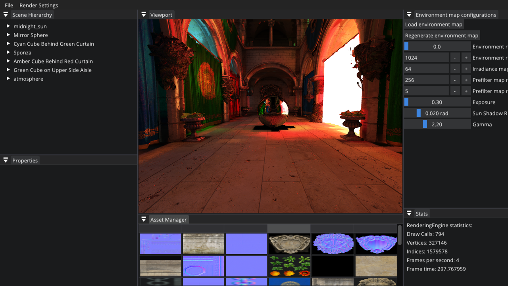

# Screen-space and voxel rendering quality review

The five diagnostic scenes below establish the original Vulkan baseline.
The [retest on the final checkout](#retest-on-the-final-checkout) compares the retained AO and SSR changes with that
baseline and records the voxel experiment separately.

## Running the scenes

Use **Open** in the editor and select a JSON world below. Each world sets its initial camera and uses engine primitives.
The scene stores its SSAO, SSR, bloom, and exposure settings. Set the voxel parameters in **Render Settings** after
opening. For the synthetic VXGI baseline use a centered 64³ grid, width 48, GI strength 1, trace depth 2,
half-resolution diffuse tracing, directional mips and voxel sun shadows. For the boundary scene use width 24. For the
Sponza check use 128³ and width 400. In a shadow-only run leave voxel sun shadows enabled and turn GI off. For an
SSR-only or SSAO-only run turn both voxel switches off.

The comparisons use matched Vulkan first frames rendered on SwiftShader at 1280×720 with a 320×240 logical window (4:3
projection, 70° vertical field of view), one sample per pixel, no bloom, with the same low-resolution environment bake
across each pair (environment 16, irradiance 4, prefilter 8 with three levels). The synthetic scenes use exposure 0.65.
Measurements are post-tone-map 8-bit channel values. Image-space comparisons use the original captures; the figure
strips are reduced for display. Moving-camera tests use independently booted fixed poses. These results characterize
spatial stability; they do not measure frame-to-frame variance at normal play speed. Native hardware timings and OpenGL
visual parity remain unverified. The original native macOS editor launch produced no captured frame. The
subsequent [checkout verification](#checkout-verification-2026-11-26) captured both applications on Apple M1 through
MoltenVK. Both debug builds passed, and the Vulkan editor and sample also reached rendered frames headlessly.

## 1. Ambient occlusion

Open the [AO contact bench](../PrehistoricEditor/res/world/diagnostics/ao_contacts.json). It contains a touching cube, a
floating cube, thin rails, bare floor, and a blocker entirely behind the initial camera.

- **Local contacts work.** With GI and voxel shadows off, turning SSAO on darkened the touching-cube patch by 4.19 red
  levels on average, the floating-cube patch by 0.42 and the rail patch by 2.20. A bare-floor control patch was
  identical. At row 435, immediately beyond the touching cube's projected right edge, the faint one-level darkening
  extended 15 pixels, cleared for 11 pixels, then returned for 12 pixels. The two-tap estimator merits a thin-feature
  test before increasing its radius.
- **The default shadow-only fallback has zero reach.** Scale every object's position and dimensions by 0.08 around the
  camera. Keep radius 2 and compare the same bench with and without the behind-camera blocker. At 128³ and width 400 the
  captures matched. At the same resolution and width 4, adding the blocker darkened 8.74% of sampled pixels and the mean
  red channel dropped 6.93 across the frame. At stock width each cell is 3.125 units; the visibility helper subtracts
  1.5 cells from a radius of only 0.64 cells. The walk cannot start. VXGI's separate diffuse cone path is outside this
  finding.
- **Far scenery suppresses local fallback.** At original scale, radius 18, width 48 and 64³, repeat the blocker on/off
  pair first with sky, then with a distant wall centered at (0, 0, −80), half-extents (180, 160, 0.1). Within the same
  bench region the maximum blocker-induced darkening fell from 45 to 9 red levels; the mean fell from 0.326 to 0.065.
  The shader credits a tap with screen coverage before checking its distance from the receiver.

Left to right: SSAO off, absolute SSAO on/off difference ×12, and the fine-grid blocker difference ×4 on the scaled
bench.

## 2. Mirror hit accuracy and handoff

Open the [mirror runway](../PrehistoricEditor/res/world/diagnostics/mirror_runway.json). Pitch down around the fixed
camera origin by 0°, 15°, 23°, 28°, 33°, 38°, 43°, and 48°. Replay with SSR off. For the independent hit check, disable
voxel lighting and render with bar emission 4 and 0. Intersect camera rays with the cube boxes and the floor's top plane
at y = −1.35, reflect about the floor normal, and reject bar hit points hidden by the pillar or outside the screen. An
emitter-induced summed absolute RGB change of at least 8 counts as a detected hit.

| Downward pitch | Analytically visible reflected bar pixels | SSR detections | Mean red on all geometric bar reflections, hybrid / voxel-only |
|----------------|------------------------------------------:|---------------:|---------------------------------------------------------------:|
| 0°             |                                    13,311 |          96.3% |                                                      250 / 122 |
| 33°            |                                     9,110 |          89.6% |                                                      201 / 122 |
| 38°            |                                     5,586 |          87.4% |                                                      162 / 123 |
| 43°            |                                         0 |              — |                                                      123 / 123 |

At 0°, each of the two 0.07-world-unit-wide bars had 981 of 1,024 visible reflected pixels detected. Only 40 of 389,015
floor pixels outside the predicted reflections picked up an emitter signal. The larger defect in this setup is **handoff
brightness**. From 33° to 43°, hybrid mean red drops by 78 levels while the voxel-only mean stays within a level. This
is a sampled angular transition, not a claim of a one-frame pop. Compare voxel representation of the narrow emitter and
captured radiance before tuning the edge fade.

Hybrid frames at 0°, 33°, and 43°:

## 3. Glossy reflections

Open the [glossy material sweep](../PrehistoricEditor/res/world/diagnostics/glossy_sweep.json). It has paired metal and
dielectric strips at roughness 0.04, 0.17, 0.19, 0.32, 0.48, 0.54, and 0.56. For the numeric control, assign every strip
the same test roughness and repeat from the same camera with the emitter on/off. This holds the screen position, view
angle, and source size fixed. Measure the positive red-channel difference at metal column 601 and dielectric column 679
across rows 418–624.

| Roughness     | Metal peak / width at half maximum | Dielectric peak / width at half maximum |
|---------------|-----------------------------------:|----------------------------------------:|
| 0.04          |                        144 / 10 px |                             119 / 10 px |
| 0.18          |                        151 / 10 px |                             119 / 10 px |
| 0.32          |                        153 / 10 px |                              110 / 9 px |
| 0.48          |                          26 / 9 px |                                8 / 9 px |
| 0.54 and 0.56 |                 No measurable peak |                      No measurable peak |

The SSR highlight loses intensity without broadening. The current shader takes a single sharp HDR sample and uses
roughness to reduce confidence. A candidate improvement is a roughness- and hit-distance-dependent radiance footprint.
It can be tested against this profile before introducing stochastic rays or temporal history.

Left to right: voxel-only, hybrid, and SSR-only emitter difference ×2. The last panel also includes the directly visible
emitter.

## 4. Voxel light leakage and bounces

Open the [sealed chambers](../PrehistoricEditor/res/world/diagnostics/sealed_chambers.json). The camera is inside the
closed receiver chamber. Toggle the hidden emitter between strengths 4 and 0. For each thickness repeat with an opening
in the partition between z = −10 and −7, leaving the full-height segments on both sides. Geometry stays fixed within
each emitter-on/off pair. Measure mean red gain inside the central rectangle from (160, 75) to (1120, 635).

| Partition thickness at 64³ | Sealed gain | Doorway gain | Sealed / doorway |
|----------------------------|------------:|-------------:|-----------------:|
| 0.5 cell (0.375 units)     |        2.55 |        26.64 |             9.6% |
| 1 cell (0.75 units)        |        2.10 |        24.37 |             8.6% |
| 2 cells (1.5 units)        |        0.91 |        18.56 |             4.9% |

With half-cell walls the largest sealed-pixel gain was 90 red levels. Keeping that geometry fixed and selecting
isotropic mips changed mean leakage to 1.99, reducing trace depth from 2 to 1 gave 0.86, and raising resolution alone to
128³ gave 3.78. Those are single-variable tests at one grid alignment. Inspect occupancy, injected radiance, and each
propagation level separately before choosing a resolution or mip policy.

Left to right: emitter off, emitter on behind the sealed half-cell partition, and emitter on with doorway.

## 5. Slat shadows, grid boundaries and Sponza

Open the [voxel boundary scene](../PrehistoricEditor/res/world/diagnostics/voxel_boundary.json). The floor meets seven
slats 0.18 units wide, under a low sun and a blue point light. A metallic sphere sits at x = 7. Use width 24 and 64³.
For the alignment sweep move the camera and all geometry and the point light together in x by 0, 0.25, 0.5, 0.75, and 1
cell; keep the distant sun and grid fixed. The screen composition stays fixed.

- A quarter-cell translation changed at least one RGB channel by 8 or more in **8.27%** of the sampled shadow-region
  pixels with VXGI and voxel shadows enabled. With both disabled the figure was **0.04%**. Moving only the grid center
  from x = 0 to −6 put the sphere across the volume boundary and changed **30.0%** of sampled pixels in its bounding
  patch by at least 32 levels.
- Isolate the sun, leave voxel shadows on and GI off, then compare against the same floor with all slats removed. Across
  geometrically predicted, camera-visible shadow pixels, **86.0%** darkened by at least four red levels. All seven
  shadows registered. In the near-contact subset, where the ray rose less than one cell before entering a slat, **2,824
  of 2,829** pixels darkened. Distal shadow coverage deserves attention before changing the contact offset. With only
  the point light contributing direct light and VXGI enabled, **55.8%** of predicted shadow pixels darkened by four blue
  levels. That last comparison also includes the slats' indirect-light contribution.
- Repeated the alignment test on **Sponza Midnight GI** at the initial yaw and at +8° and +16°. Keep the world and
  camera fixed within each pair; shift only the stock grid center by 0.78125 units (one quarter cell). **19.9–21.7%** of
  sampled pixels in the central region changed by at least eight levels and **3.8–4.1%** by at least 32. This verifies
  sensitivity to world/grid alignment in the production scene. Moving the camera alone does not move this fixed grid.

Boundary frames at zero and quarter-cell offset, followed by their absolute difference ×4:

Sponza at the saved pose, followed by matched sphere crops with voxel-only and hybrid reflections:

## Decision

1. Correct AO coverage accounting and define a fallback policy for radii smaller than the representable voxel scale.
   Retest the behind-camera blocker, the distant backdrop and the bare floor. A coarse occupancy cell cannot recover
   subcell geometry.
2. Investigate grid alignment and thin-emitter energy loss using the slats, runway and sealed chambers. Compare occupied
   cells, injected radiance and propagated levels at fixed world poses and equal budgets. These tests will also serve as
   acceptance cases for adaptive voxels.
3. Evaluate glossy SSR filtering using the fixed-column profiles, then remeasure the angular handoff. Measure per-pass
   GPU cost on native hardware before selecting a quality preset.

All ROI percentages except the analytic mirror and shadow coverage tests use every second pixel in both axes. Pixel
coordinates start at the top left. The shadow-region rectangle was (120, 360)–(1050, 625), the sphere patch (58, 340)–(
226, 448), and the Sponza rectangle (320, 140)–(980, 560). The original diagnostic pass established candidate fixes
without changing renderer algorithms. The retained changes and their subsequent verification are recorded below.

## Retest on the final checkout

### Ambient occlusion

Only nearby valid depth samples now count toward screen coverage. The fallback begins at the exit of the receiver's own
voxel and tests the rest of the configured world-space radius. The old local-light endpoint bias could consume the
entire AO segment. Skipping the receiver cell also means a blocker represented only by that cell cannot be distinguished
from the receiver.

| Blocker on/off comparison                | Original mean red change | Final mean red change |
|------------------------------------------|-------------------------:|----------------------:|
| Scaled scene, stock width 400            |                     0.00 |                  0.00 |
| Scaled scene, fine width 4               |                    −6.93 |                 −2.15 |
| Sky / distant wall, full frame           |            −6.25 / −3.32 |         −1.85 / −1.85 |
| Sky / distant wall, original bench patch |          −0.326 / −0.065 |       −0.066 / −0.066 |

The backdrop no longer determines the fallback response. The fine grid darkened 7.36% of sampled pixels. The provisional
stock-grid response (−3.79) depended on the experimental voxel changes and disappeared after restoring the original
bake. The stock thin-blocker case remains open. Screen-only mean darkening at the touching cube, floating cube and rail
stayed at 4.19, 0.42 and 2.20 respectively. The bare-floor patch remained identical.

### Glossy reflections

Widths below count pixels at or above half the peak emitter-induced red gain, with a two-level noise floor. Peaks are
post-tone-map red levels. The same fixed screen columns and emitter on/off controls were used for both builds.

| Roughness | Metal width, original → final | Dielectric width, original → final | Final metal / dielectric peak |
|-----------|------------------------------:|-----------------------------------:|------------------------------:|
| 0.04      |                       10 → 10 |                            10 → 10 |                     144 / 119 |
| 0.18      |                       10 → 17 |                            10 → 17 |                     150 / 118 |
| 0.32      |                       10 → 20 |                             9 → 20 |                     156 / 112 |
| 0.48      |                        9 → 19 |                             9 → 11 |                       99 / 41 |
| 0.54      |                        0 → 10 |                              0 → 0 |                         6 / 1 |
| 0.56      |                         0 → 0 |                              0 → 0 |                         0 / 0 |

The central ray still resolves smooth mirrors. Rougher surfaces gather radiance over a footprint determined by
roughness, hit distance and projection. The measured footprint broadens through 0.32. At higher roughness, confidence
fades toward the fallback and the width ceases to grow. At 0.48 the metal peak also rose from 26 to 99, so the visible
change includes a brighter reflection.

Matched emitter-on minus emitter-off crops at roughness 0.32. The original is on the left and the final checkout is on
the right.

### Mirror handoff and chambers

The mirror runway retained exactly the baseline analytic detection counts at all four pitches: 12,819 / 13,311 at 0°,
8,166 / 9,110 at 33°, 4,880 / 5,586 at 38°, and no visible reflected emitter at 43°. Mean hybrid red on geometric bar
reflections remained 249.64, 200.64, 162.12 and 122.52 respectively. The off-screen brightness loss remains
reproducible.

The half-, one- and two-cell partitions reproduced the baseline sealed gains of 2.55, 2.10 and 0.91 red levels and the
doorway gains of 26.64, 24.37 and 18.56. The lower leakage measured in the experimental build does not carry into this
checkout.

### Slat shadows and Sponza

The quarter-cell slat translation changed 8.27% of sampled shadow-region pixels by at least eight levels, matching the
baseline. Moving the grid center to −6 changed 30.03% of the sphere patch by at least 32 levels. The isolated sun still
covered 2,824 of 2,829 predicted near-contact pixels. For Sponza's quarter-cell grid shift, the eight-level change rates
at the saved pose, +8° and +16° were 20.03%, 19.94% and 21.66%. All three returned to baseline precision.

### What the voxel experiment showed

At the default runway pose, a readback of the 64³ grid showed 2,044 occupied cells and **zero cells with nonzero encoded
emission**. Sampling each projected voxel face at 2×2 positions and matching the visible material's emission scale
produced 2,181 occupied cells, including 16 with emission. This explains why tuning SSR's screen-edge fade alone cannot
restore the missing thin emitters in this pose.

In the sealed half-cell chamber, the original bake placed all 46 emissive cells on the source side. At trace depth one,
the mean emitter-induced red gain in occupied receiver-side cells was zero. At depth two it reached 0.0017 in the grid's
linear radiance units. These readbacks distinguish a small propagated signal from the larger visible leakage after cone
filtering and tone mapping.

The combined voxel experiment improved the sealed/open gain ratio from 9.6% to 3.0% and reduced quarter-cell slat
sensitivity from 8.27% to 5.53%. At Sponza's saved pose, quarter-cell sensitivity rose from 20.03% to 52.60%. The final
checkout retains the original voxel bake, cone filtering and specular trace origin. A follow-up experiment should
isolate projected coverage, emissive energy and filtering individually, using both Sponza and the thin emitters as
acceptance cases.

### Verification limits

All 133 matched Vulkan captures completed with identical input scene descriptions and no validation errors. Both debug
builds completed, and all 27 CPU contract tests passed. The editor loaded the glossy sweep and the sample loaded its
default world with four-sample MSAA. Both produced complete Vulkan frames using SwiftShader, a headless GLFW backend and
the Vulkan validation layer. The OpenGL shader checks, Vulkan SPIR-V/Metal compilation checks and PBR/background
contract checks passed. A windowed macOS editor launch produced no captured frame within 45 seconds. Native GPU timings
and a rendered OpenGL comparison remain open.

The glossy path retains the single ray for mirror surfaces. A glossy pixel can issue up to four additional screen
marches on a central miss and gather up to 25 radiance samples around a hit. The added cost depends on material coverage
and misses; these software-rendered captures establish image quality only.

## Checkout verification 2026-11-26

**The retained AO and glossy SSR checkout has been verified. The wider render-quality work is not complete.**
The renderer diff remains limited to `ambient_occlusion.glsl`, `screen_reflection.glsl`, and
`voxel_visibility.glsl` in the shared shader tree. No voxel occupancy, injection, propagation,
or mip-generation experiment remains in the diff. This verification made no further renderer changes.
The review, five diagnostic worlds, comparison images and shader changes remain uncommitted.

### Retained fixes

- AO counts only valid depth samples within its radius as screen coverage. Its voxel fallback starts
  after the receiver cell and respects the configured world-space radius, independently of the local-light bias.
- Glossy SSR filters radiance over a projected footprint based on roughness and hit distance, with
  bounded edge probes and surface rejection. Smooth mirrors retain the original central-ray result.
- Both backends include the shared implementations. Source inspection checked their callers, texture
  bindings and existing synchronization; runtime Vulkan checks below supplement that inspection.

### Builds and checks

| Check                                                                                 | Result                                                                                                                                                                                                                                      |
|---------------------------------------------------------------------------------------|---------------------------------------------------------------------------------------------------------------------------------------------------------------------------------------------------------------------------------------------|
| `premake5 cmake`, `cmake --preset debug`, `cmake --build --preset debug --parallel 4` | Passed; the existing debug configuration builds x86_64.                                                                                                                                                                                     |
| `cmake -S . -B cmake-build-debug`, `cmake --build cmake-build-debug --parallel 4`     | Passed; full arm64 Debug rebuild, including both applications and resources.                                                                                                                                                                |
| Shared resource staging                                                               | All three changed shared shader files match source in both build packages. All 43 staged Vulkan modules passed `spirv-val --target-env vulkan1.1`.                                                                                          |
| OpenGL shader compilation                                                             | Seven expanded entry points passed `glslangValidator`, including PBR AO and the SSR compute shader. This is compilation, not OpenGL runtime verification.                                                                                   |
| Vulkan portability compilation                                                        | Seven relevant Vulkan stages passed GLSL compilation, SPIR-V validation, SPIRV-Cross Metal translation and Metal compilation.                                                                                                               |
| `python3 tests/vulkan_pbr_contract.py`                                                | Passed.                                                                                                                                                                                                                                     |
| `python3 tests/vulkan_background_contract.py`                                         | Passed.                                                                                                                                                                                                                                     |
| `OpenALSmoke` with `ALSOFT_DRIVERS=null`                                              | Passed: context and buffer creation; no speaker-output claim.                                                                                                                                                                               |
| `VulkanComputeSmoke` on Apple M1 / MoltenVK                                           | Passed: 256 values and pipeline recreation; zero validation errors.                                                                                                                                                                         |
| `python3 tests/vulkan_ibl_smoke.py` on Apple M1 / MoltenVK                            | Passed: panorama/atmosphere IBL, cube faces, convolution, roughness mips and BRDF LUT; zero validation errors.                                                                                                                              |
| `python3 tests/resource_pipeline.py`                                                  | **Failed** at line 48: the existing test asserts exactly seven SPIR-V files, while the current manifest produces 43. This assertion is also present in HEAD. Later checks in this script did not run; the test was not changed or bypassed. |
| Documentation / diff                                                                  | Local review/backlog link targets exist; diagnostic JSON parses; `git diff --check` passed.                                                                                                                                                 |

The optional smoke executables were built explicitly with
`cmake --build --preset debug --target OpenALSmoke VulkanComputeSmoke --parallel 4`.
The compute invocation used `build/debug/vulkan_compute.spv`. Native GPU checks selected
`VK_DRIVER_FILES=/usr/local/share/vulkan/icd.d/MoltenVK_icd.json` and ran outside the sandbox.
The builds still emit existing Premake deprecations, compiler warnings and a missing Tcl/Tk library-search-path warning.

### Application boots

- The unmodified x86_64 Debug editor ran from `PrehistoricEditor/` on Apple M1 through MoltenVK.
  Eight presented-frame captures included four Sponza viewport frames and four detached Stats-panel frames.
  The sample ran from `Prehistoric/`, with `PREHISTORIC_WORLD` selecting the diagnostic mirror runway,
  and produced eight scene captures. Both final runs had **zero Vulkan validation errors**.
- All five diagnostic worlds also rendered in a fresh arm64 editor relink using null GLFW and SwiftShader,
  four samples per pixel and reduced environment-bake resolutions. These isolated harness runs used temporary
  application resource directories and had no reported Vulkan validation errors.
- The sandboxed window launch failed to capture a frame and logged macOS service-connection errors.
  A first unrestricted x86_64 run encountered an incompatible arm64 KosmicKrisp driver during discovery;
  explicitly selecting MoltenVK removed those loader errors. The successful windowed runs still logged
  `Cocoa: Regular windows do not have icons on macOS` and `Cocoa: Failed to find service port for display`.
  These messages did not prevent the captured frames. Native input, window-management correctness and
  OpenGL visual parity were not tested in this pass.

Native editor Sponza frame and sample mirror-runway frame, reduced for display:

### Fresh quality retest

Rebuilt the temporary capture harness against the current arm64 engine and resource package and rendered
**54 fresh Vulkan/SwiftShader cases**, without reusing completion markers. Their scene JSON matches the original
baseline fixtures. This harness substitutes null GLFW and injects voxel settings into a temporary sample-app
translation unit; the native application boots above are separate checks of the unmodified executables.
Capture settings and measurement regions match the earlier retest. All 54 cases completed without reported
Vulkan validation errors. [The verification record](render-quality/checkout-verification.json) preserves the
source hashes, capture hashes, AO/chamber measurements and analytic mirror results.

- AO backdrop controls reproduced the same **−1.848** mean red change with sky and with a distant wall.
  The fine-grid blocker reproduced **−2.152**; the stock-grid blocker remained **0.000**.
- The glossy profiles reproduced the table above: metal width **10 → 20 px** at roughness 0.32,
  with the 0.04 mirror control staying at 10 px. This is a broader and sometimes brighter highlight,
  not a claim of energy conservation or native performance improvement.
- The analytic mirror detections remained **12,819 / 13,311**, **8,166 / 9,110**, and **4,880 / 5,586**
  at 0°, 33° and 38°. The hybrid red means remained **249.64, 200.64, 162.12, 122.52** across the four poses.
- Chamber sealed/doorway gains reproduced **2.550 / 26.642**, **2.098 / 24.373**, and **0.913 / 18.559**.
  The slat and Sponza alignment captures matched the previous final captures byte-for-byte.
- 52 of the 54 images matched the previous final captures byte-for-byte. The two-cell chamber dark/sealed
  images differed in 28 and 8 colour channels, respectively (maximum differences 32 and 14); their reported
  ROI means remain unchanged at two decimal places. No claim of complete run-to-run determinism is made.

### Still open

1. **Coarse-grid AO:** a blocker occupying only the receiver cell cannot be recovered by this representation;
   the stock-width thin-blocker diagnostic still fails to produce occlusion.
2. **SSR handoff:** reflections still lose brightness as emitters leave the screen. The retained filtering
   does not fix voxel thin-emitter energy loss or the environment/voxel brightness mismatch.
3. **Voxel quality:** thin-wall leakage, grid-alignment sensitivity and boundary transitions remain.
   The rejected experiment's synthetic improvements are not present in this checkout.
4. **Quality/performance acceptance:** native per-pass timings, continuous camera-motion stability,
   OpenGL runtime comparison and broader glossy-scene/energy checks remain unverified.
5. **Platform startup:** the Cocoa startup messages remain. The resource-pipeline test failure recorded
   above was resolved in the follow-up below.

### Resource-pipeline follow-up

The full `python3 tests/resource_pipeline.py` run now passes. It reads evaluated shader declarations
from CMake's expanded JSON trace and compares exact output paths: 43 shaders in the default build
and installed package, and 44 in a separate experimental build. Missing and unexpected outputs
produce explicit diagnostics; no fixed shader count is asserted.

The remaining suite exposed two other stale assumptions, both corrected in the test: newly added
engine assets such as `sun_flare.png` do not automatically reserve legacy `res/...` aliases, and
sample-package checks must cover only the staged `models/`, `textures/` and `sounds/` trees, not
root-level machine metadata. Engine migration aliases remain explicit test expectations; sample
aliases follow `SharedSampleAssets.h`. Portable-ID lookup and byte comparisons still cover every
packaged model, texture and sample asset.

Incremental compilation, include additions/edits/removal, deliberate compiler failures, no-op
builds, sample-only updates, install staging, both executable layouts, overrides and missing-resource
errors all passed. Runtime resolver and renderer code were unchanged.

The full debug generation/configure/build also passed. Fresh null-GLFW/SwiftShader editor and sample
boots captured rendered frames without reported Vulkan validation errors. The windowed MoltenVK
editor retry logged the Cocoa icon message and remained at zero FPS until the 90-second capture
timeout; no frame was captured in that retry. This does not supersede the successful native captures
from the earlier checkout verification, and no new native-window success is claimed for this follow-up.

### Native editor stall and Stats docking follow-up

The zero-FPS retry exposed a CPU-side render gate, not a Vulkan submission failure.
`Input::pauseRendering` was uninitialized, so startup could skip rendering until a focus event
wrote it. Independently, losing the main window's focus set that flag even when an editor
platform window had focus. The loop continued updating and logging zero rendered frames.
The saved ImGui layout explicitly placed Stats in a detached platform window.

The input constructor now initializes both pause flags to false. The editor keeps rendering
when unfocused, while the sample retains its focus-pause policy and both retain their existing
iconification handling. Stats now occupies its own dock below Environment map configurations on the right. Startup
migrates the
old detached/tabbed arrangement without resetting the other panel positions; an already-correct
split is reused. Stats cannot be dragged out or covered by a newly docked tab. No machine-local
ImGui layout is tracked in Git.

The implementation follows the distinction between focus and iconification in the
[GLFW window guide](https://www.glfw.org/docs/latest/window_guide.html), the continuously serviced
event/render loop in
the [ImGui Vulkan sample](https://github.com/ocornut/imgui/blob/docking/examples/example_glfw_vulkan/main.cpp),
and the existing DockBuilder approach described
in [ImGui's docking guide](https://github.com/ocornut/imgui/wiki/Docking).
Keeping the editor live while unfocused supports multi-window editing without changing the sample's
background-rendering policy. Migrating the existing dock tree preserves user layout choices instead
of replacing the entire saved layout.

Verification on 2026-11-26:

- Full debug and arm64 builds passed. The native verification executable was confirmed as Mach-O arm64.
- A placement-construction probe over nonzero storage reproduced the incorrect initial paused state
  before the constructor fix and passed afterward.
- A probe using the production docking block and vendored ImGui passed fresh-layout, legacy detached
  Stats migration, and save/reload checks. Stats was visible below Properties in the main viewport;
  saving and reloading did not add another split.
- Two native arm64 editor launches on Apple M1/MoltenVK each reached frame 20, capturing frames
  1, 4, 8, 12, 16 and 20. Switching focus to Finder after frame 4 did not stop rendering.
  All twelve captures were full main-window scene frames, with Stats visibly below Properties.
  Both runs reported **zero Vulkan validation errors**. The second launch reused the saved dock layout.
- The native debug/validation scene ran at roughly **4 FPS** after startup. This verifies progress
  and correct presentation, not acceptable interactive performance or a performance improvement.
  Cocoa icon/display-service messages remain. Native minimize/restore and OpenGL parity were not
  exercised in this follow-up.

The requested placement was subsequently corrected to the right side, below **Environment map
configurations**. The migration also handles the earlier left-side Stats dock. Fresh, detached,
and left-docked layout fixtures all passed migration and save/reload checks. The earlier native
capture counts above describe the initial left-side placement.
The corrected right-side layout then passed a native arm64 M1 run through frame 20 with zero Vulkan
validation errors, including rendering after focus moved to Finder. The image above shows this final placement.
